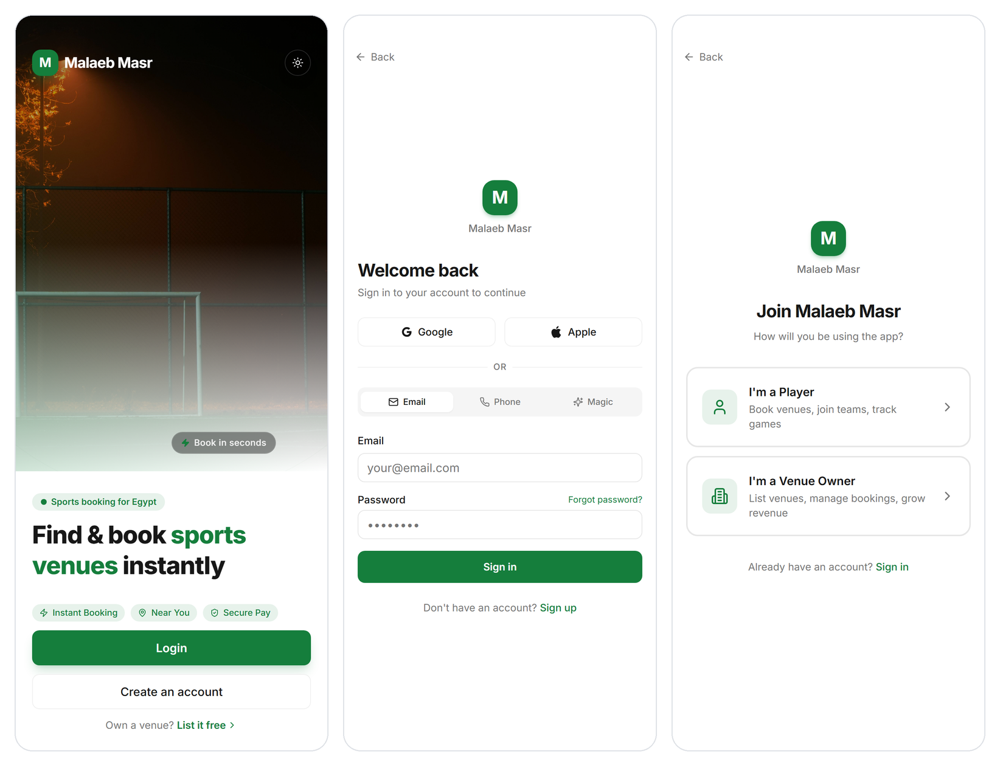
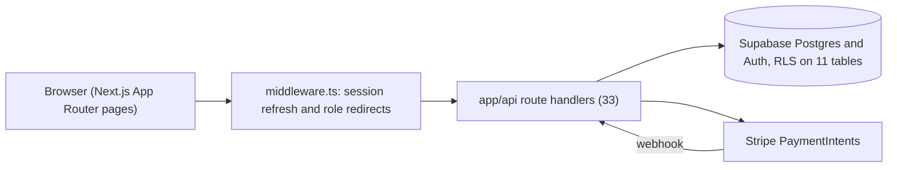

<h1 align="center">Malaeb Masr</h1>
<p align="center">Book football pitches, courts and pools in Egypt. Players book and pay, owners manage slots and see bookings.</p>
<p align="center">
  <a href="https://v0-sports-facility-app-design.vercel.app">Hosted UI</a> ·
  <a href="#architecture">Architecture</a> ·
  <a href="#run-locally">Run locally</a> ·
  <a href="#status">Status</a>
</p>
<p align="center">
  
  
  
</p>
<p align="center"></p>

## Features

Players
- Search venues by sport, district, price range and free text.
- Pick a facility and a time slot, then book. Bookings move through pending, confirmed, upcoming, past and canceled.
- Pay with a Stripe PaymentIntent in EGP. A signed webhook marks the booking paid.
- Get a QR ticket for a paid booking.
- Sign in with email and password, phone OTP, magic link, Google or Apple, through Supabase Auth. Request a password reset email.
- Create and join teams, read notifications, see venue reviews.
- Dark mode.

Owners
- Create venues and add facilities with prices.
- See incoming bookings across their venues.
- Read dashboard analytics: total bookings, revenue, revenue by month for six months, average rating and occupancy.

## Architecture



- `middleware.ts` refreshes the Supabase session, sends signed-out users to `/auth/login`, and keeps the `player`, `owner` and `admin` surfaces apart. Owners and admins land on `/owner`, players on `/dashboard`.
- `app/api/` holds the route handlers: auth (including phone OTP), venues and availability, bookings and QR, teams, notifications, favorites, owner analytics and payments (initiate, verify, webhook).
- `lib/supabase/` has the browser, server and service-role clients. `lib/validations/` holds the zod schemas the routes parse with.
- `lib/stripe.ts` creates PaymentIntents and checks webhook signatures. `lib/paymob.ts` is a Paymob client (auth token, order, payment key, HMAC check) that no route calls yet.
- `supabase/migrations/` defines the schema and the row level security policies.

## Data model

Eleven tables in the `public` schema, all with RLS enabled:

| Table | Holds |
| --- | --- |
| `profiles` | One row per auth user: name, phone, role (`player`, `owner`, `admin`), sports |
| `venues` | Listings owned by a profile: location, district, sports, amenities, images, rating |
| `facilities` | Bookable units of a venue (a pitch, a court, a pool) with a price |
| `availability_slots` | Weekly open hours per facility |
| `bookings` | Date, start time, duration, price, `status` and `payment_status` |
| `reviews` | Ratings and comments on venues |
| `teams` | Teams with a sport, a captain and an invite code |
| `team_members` | Membership with `captain` or `member` role |
| `notifications` | Per-user inbox with a read flag |
| `payment_methods` | Saved methods: card, wallet or Fawry |
| `favorites` | A user's saved venues |

## Run locally

Requirements: Node.js 20 or newer, pnpm, and a Supabase project.

```sh
pnpm install
cp .env.example .env.local   # then fill in the values
pnpm dev
```

1. Create a Supabase project and open its SQL editor.
2. Run `supabase/migrations/001_initial_schema.sql`, then `002_venues_patch.sql`, in that order.
3. Fill `.env.local` (see Configuration). Stripe keys come from test mode.
4. Start the app and open http://localhost:3000.
5. To receive payment events locally, forward Stripe webhooks to `http://localhost:3000/api/payments/webhook` with the Stripe CLI and use the signing secret it prints.

`pnpm build` and `pnpm start` build and serve the production bundle. `lib/stripe.ts` throws at import time without `STRIPE_SECRET_KEY`, so set it (a placeholder is enough) before building.

## Configuration

| Variable | Required | Purpose |
| --- | --- | --- |
| `NEXT_PUBLIC_SUPABASE_URL` | Yes | Supabase project URL |
| `NEXT_PUBLIC_SUPABASE_ANON_KEY` | Yes | Supabase anon key, limited by RLS |
| `SUPABASE_SERVICE_ROLE_KEY` | Yes | Server only. Used by register, profile and payment routes |
| `NEXT_PUBLIC_APP_URL` | For payments | Public base URL for payment redirects and QR ticket links |
| `NEXT_PUBLIC_SITE_URL` | No | Base URL for password reset links. Falls back to the request origin |
| `STRIPE_SECRET_KEY` | Yes | Stripe secret key |
| `STRIPE_WEBHOOK_SECRET` | For payments | Signing secret for `/api/payments/webhook` |
| `PAYMOB_API_KEY`, `PAYMOB_IFRAME_ID`, `PAYMOB_HMAC_SECRET` | No | Read by `lib/paymob.ts`, which no route uses yet |

## Status

This project started from a v0.dev scaffold (Next.js 14 and shadcn/ui). The API routes, the Supabase schema, auth, middleware and the payment code were written by hand on top of it.

- The hosted UI at the link above is still online. Its backend is offline, so screens that load data (search, bookings, owner dashboard) come up empty.
- Some screens still use `lib/mock-data.ts`: the team detail page, and the venue card and map components. The map uses a mock user location.
- The booking screen creates a booking and a PaymentIntent on the server but does not confirm the payment with Stripe Elements yet. Paymob is not wired to any route.
- QR tickets are rendered through api.qrserver.com. The verify URL inside the QR payload has no route yet.
- The favorite button on the venue page calls `/api/venues/[id]/favorite`, which does not exist. The working routes are under `/api/users/me/favorites`.
- The UI is English only. The Language row on the profile screen is not wired up.
- `next.config.mjs` skips TypeScript and ESLint errors during `next build`. `tsc --noEmit` currently reports one error, in `app/venue/[id]/page.tsx`. There are no automated tests.

## License

MIT. See [LICENSE](LICENSE).
